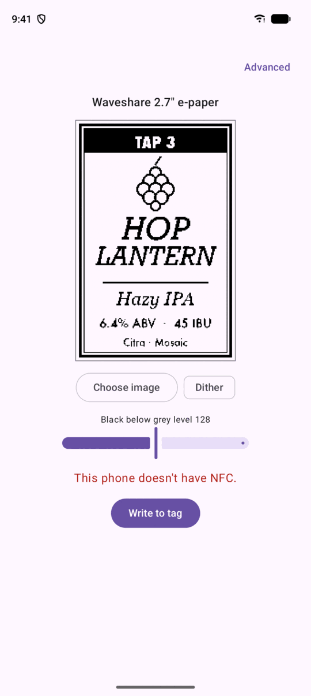
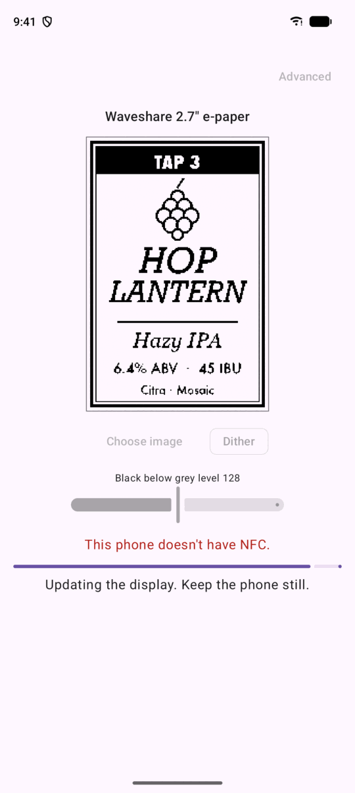
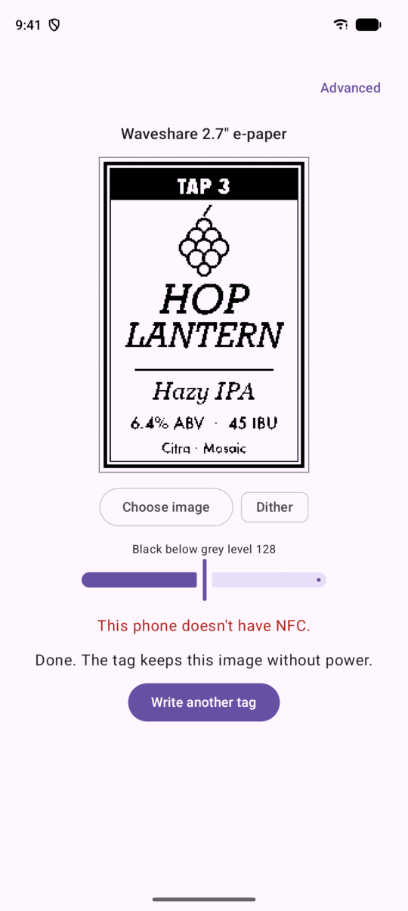
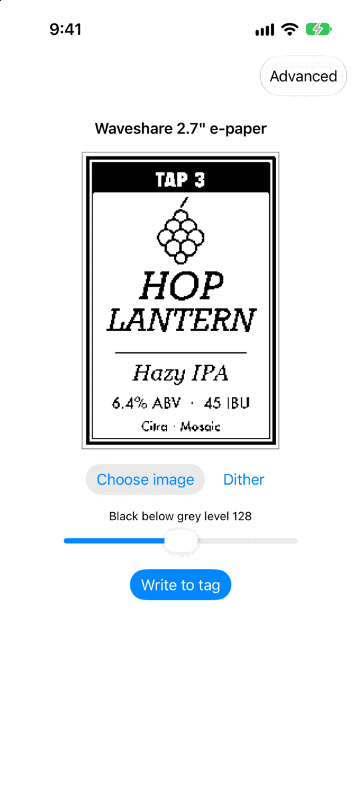
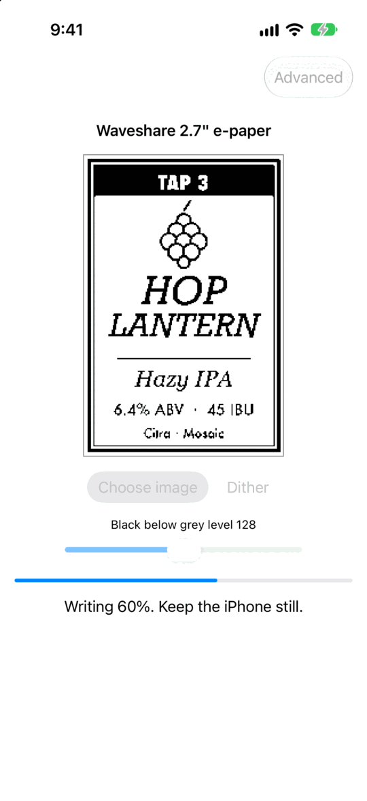
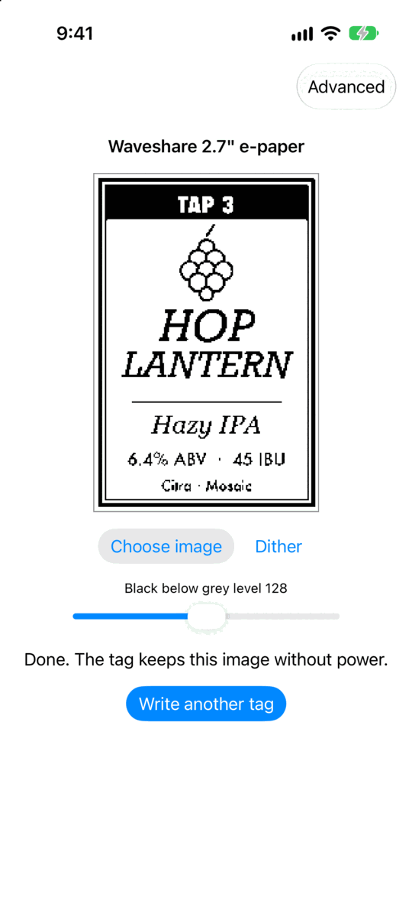

# KegInker

An open-source Android and iOS app for keg tap-handle labels on
battery-free NFC e-paper tags. Pick what's pouring, preview the label, tap
your phone to the handle, and the label stays after you walk away.

Made for homebrewers and just as at home in a taproom. It writes to
Waveshare's 2.7" NFC-powered e-paper today, and can write any image for
custom labels.

## Screenshots

Preview, write, done. Captured in the Android emulator and iOS Simulator
with a simulated tag; the emulator has no NFC, hence its warning.

| | Preview | Writing | Done |
|---|---|---|---|
| Android |  |  |  |
| iOS |  |  |  |

## Principles

- **Reliable writes.** Generous timeouts, clear progress, a completion check
  and clean retry.
- **Native feel.** SwiftUI on iOS and Jetpack Compose on Android, over a
  shared Kotlin Multiplatform core.
- **Minimal permissions.** NFC and the photo picker. No network, accounts
  or telemetry.

## Status

Early development. See [USAGE.md](USAGE.md) for supported displays and how to
try a development build.

## Documentation

- [CONSTITUTION.md](CONSTITUTION.md): mission, principles, non-goals
- [CONTRIBUTING.md](CONTRIBUTING.md): building, testing, layout
- [SECURITY.md](SECURITY.md): reporting a vulnerability
- [docs/architecture/](docs/architecture/): design and tag protocols
- [docs/decisions/](docs/decisions/): decision records
- [docs/guides/](docs/guides/): how-tos
- [docs/operations/](docs/operations/): CI

## License

[Apache License 2.0](LICENSE). See [NOTICE](NOTICE) for attributions.
